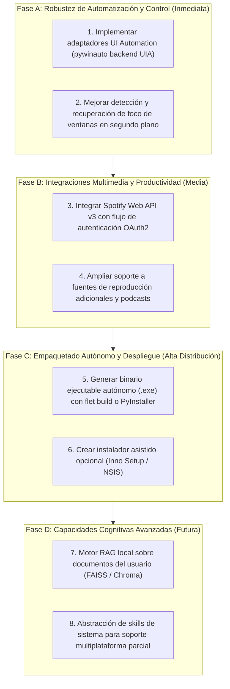

# Plan de Proyecto — AURA (Orion)
> **Asistente Universal con Respuesta Automatizada**  
> *Documento de Planificación, Estado Actual, Arquitectura y Hoja de Ruta*  
> *Versión del Software: 1.4.15 | Plataforma objetivo: Windows 10/11 64-bit | Runtime: Python 3.11.x*

---

## 1. Descripción del Proyecto

### 1.1 ¿Qué es AURA?
**AURA** (nombre interno de desarrollo: **Orion**) es un asistente de escritorio modular, inteligente, interactivo y portable desarrollado en Python. Ha sido diseñado específicamente para asistir a estudiantes, desarrolladores e investigadores en sus tareas cotidianas de productividad, estudio, gestión operativa del sistema operativo y desarrollo de software.

A diferencia de los clientes de chat convencionales, AURA integra una interfaz gráfica completa (GUI reactiva sobre Flet) con acceso controlado al sistema operativo Windows, procesamiento de voz en tiempo real y una arquitectura multi-proveedor de Inteligencia Artificial que prioriza la soberanía de los datos del usuario.

### 1.2 Objetivo Principal
El objetivo primordial de AURA es proporcionar una **asistencia digital integral bajo la filosofía *Local-First***:
1. **Privacidad y Autonomía**: Capacidad de operar al 100% de manera local y desconectada mediante modelos de lenguaje ejecutados en **Ollama** (ej. `qwen2.5:3b`, `llama3.2:3b`), modelos acústicos de transcripción de voz locales (**faster-whisper**) y motores de conversión vocal neuronal (**RVC**), garantizando que las conversaciones y archivos sensibles nunca salgan del equipo del usuario.
2. **Capacidad Operativa en el Sistema**: Actuar no solo como un modelo conversacional, sino como un agente ejecutor capaz de comprender instrucciones simples o compuestas en lenguaje natural (por texto o por voz), descomponerlas en pasos lógicos y ejecutarlas sobre el entorno de Windows (gestión de archivos, control de aplicaciones, inyección de texto en editores, manipulación de documentos de Office y reproducción multimedia).
3. **Portabilidad Estricta**: Funcionar sin necesidad de instaladores globales invasivos, operando dentro de su propio entorno virtual portable (`%~dp0env`) con dependencias aisladas y scripts de inicialización basados en rutas relativas deterministas.
4. **Degradación Elegante y Flexibilidad**: Permitir la conexión transparente con proveedores en la nube de alto rendimiento (OpenAI, Anthropic, Google Gemini, xAI Grok) cuando el usuario así lo decida, pero manteniendo siempre mecanismos de contingencia (*fallback*) hacia el motor local ante caídas de red o límites de cuota.

---

## 2. Estado Actual

El proyecto se encuentra en una etapa madura y funcional, correspondiente a la **Versión 1.4.15** (Fase 81 finalizada). Cuenta con una suite completa de más de 60 archivos de pruebas automatizadas en `pytest` y validación estática de código con `pyflakes` (0 advertencias).

### 2.1 Funcionalidades Implementadas y Operativas

| Área / Módulo | Funcionalidades Específicas en Funcionamiento | Estado |
| :--- | :--- | :---: |
| **Interfaz Gráfica (Flet 0.86.5)** | • Ventana principal con barra superior (`TopBar`), barra lateral colapsable (`Sidebar`) y barra de estado (`StatusBar`).<br>• Seis vistas operativas: Chat, Habilidades (Skills), Automatizaciones, Explorador de Archivos, Asistente de Código y Ajustes.<br>• Selector visual de temas con 12 variantes de color y soporte de tema claro/oscuro.<br>• Soporte de fondos de pantalla personalizados (imágenes JPG/PNG y GIFs animados con reproductor por cuadros desacoplado y preview estático seguro).<br>• Asistente de configuración inicial en 5 pasos (`SetupWizard`) activado en el primer inicio (`FIRST_RUN=true`). | ✅ 100% Funcional |
| **Pipeline de Comprensión (NLP Multinivel)** | • **Capa 1 (IntentRouter)**: Enrutamiento determinista por expresiones regulares para 13 intenciones formales (`open_app`, `close_app`, `create_file`, `delete_file`, `write_in_app`, `save_app_doc`, `media_play`, etc.).<br>• **Capa 2 (FuzzyInterpreter & TypoMemory)**: Reconocimiento difuso mediante `difflib.SequenceMatcher` y aprendizaje continuo de errores tipográficos en `data/learning/typo_memory.json`.<br>• **Capa 3 (Intérprete LLM)**: Inferencia estructurada vía JSON con temperatura fija (`T=0.10`) para casos no resueltos por capas previas.<br>• Protección de slots entre comillas (`extract_slots` / `§0`, `§1`...) para evitar fracturas de cadenas por conjunciones. | ✅ 100% Funcional |
| **Planificador Multi-Paso (Planner & Automation)** | • Descomposición de oraciones complejas con conjunciones ("y", "luego", "después") y resolución de anáforas ("en esa app", "guardalo").<br>• Prevalidación estricta de viabilidad contra la matriz de capacidades de aplicaciones (`data/app_capabilities.json`).<br>• `AutomationEngine`: Ejecución secuencial con temporizadores, reintentos, políticas configurables ante fallos (`stop` / `continue`) y reporte dinámico en chat con checklist visual (⚪, ⏳, ✅, ❌). | ✅ 100% Funcional |
| **Integración con Windows (Win32 & COM)** | • `AppScanner` y caché rápida (`AppIndexManager`): Detección profunda de ejecutables en carpetas estándar, accesos directos (`.lnk`) y el registro de Windows (App Paths).<br>• `OfficeAdapter`: Conexión nativa COM estricta contra la Running Object Table (`GetActiveObject`) para Microsoft Word y Excel con guardado `.docx`/`.xlsx` sin crear instancias huérfanas invisibles.<br>• Eliminación segura hacia la Papelera de Reciclaje mediante `send2trash`.<br>• Modales obligatorios de confirmación previa para operaciones destructivas (`CONFIRM_DESTRUCTIVE=true` para vaciar papelera, borrar archivos o apagar/reiniciar la PC). | ✅ 100% Funcional |
| **Subsistema Multi-Proveedor de IA** | • Fábrica única centralizada (`AIProviderFactory`).<br>• Proveedores integrados: Ollama (local), Google Gemini (`gemini-2.0-flash`), OpenAI (`gpt-4o-mini`), Anthropic (`claude-3-5-haiku-latest`), xAI Grok y Custom endpoints compatibles con OpenAI.<br>• Cliente HTTP propio (`AIHttpClient`) basado en `requests` puro con backoff exponencial, sin SDKs externos pesados.<br>• `FallbackProvider`: Si falla la API en la nube, conmuta automáticamente a Ollama local con aviso al usuario.<br>• Prompt Maestro Canónico (`aura/ai/prompts/maestro.md`) con ensamblado dinámico y omisión automática de ejemplos para modelos de bajos recursos ($\le 4\text{B}$). | ✅ 100% Funcional |
| **Voz, Audio y Reconocimiento (STT/TTS/RVC)** | • Captura y detección de actividad por voz (VAD) vectorizada por energía RMS (`AudioManager`). Auto-envío tras pausa por silencio.<br>• **STT**: Transcripción local con `faster-whisper` (CTranslate2, cuantización INT8) y fallback a Google Web Speech API (`SpeechRecognition`).<br>• **TTS**: Síntesis neural con `edge-tts` y motor offline local con `pyttsx3`.<br>• **RVC (Retrieval-based Voice Conversion)**: Clonación y conversión tímbrica neuronal (`aura.pth` + `.index`) sobre CPU o GPU CUDA.<br>• `MessageSpeaker`: Locución de mensajes bajo demanda desde botones integrados en cada burbuja del chat. | ✅ 100% Funcional |
| **Reproductor Multimedia (`MediaPlaySkill` v2)** | • Búsqueda mediante YouTube Data API v3 y apertura automática en el navegador preferido con parámetro `&autoplay=1`.<br>• Soporte para YouTube Music, YouTube y enlaces profundos de Spotify (`spotify:search:<query>`). | ✅ 100% Funcional |
| **Memoria y Personalidad** | • `UserMemory`: Grafo de memoria a largo plazo atómico en UTF-8 (`data/memory/user_memory.json`) con preferencias, proyectos recientes y alias.<br>• Sistema de personalidades (`profesional`, `amigable`, `sarcastico`, `sin_filtro`) y banco local de humor/chistes para evitar bloqueos o alucinaciones. | ✅ 100% Funcional |
| **Portabilidad, Auditoría y Empaquetado** | • Scripts batch portables con `%~dp0`: `Aura.bat`, `setup_env.bat`, `test.bat`, `backup.bat`.<br>• Acceso directo oficial `Aura.lnk` con ícono multipágina waifu Lanczos.<br>• `scripts/disk_audit.py`: Auditoría recursiva de espacio en disco en MB.<br>• `scripts/safe_clean.py`: Poda de cachés, logs rotados y modelos Whisper no utilizados.<br>• `scripts/make_release.py`: Generador de archivo ZIP limpio (~65 MB) con exclusión estricta de secretos (`.env`) y del entorno virtual (`env/`). | ✅ 100% Funcional |

### 2.2 Partes Pendientes, Limitaciones o Trabajo Futuro Documentado

Basado estrictamente en las especificaciones del código y la documentación técnica oficial (`PROMPT_BASE.md` y `TECHNICAL_DOCS.md`), existen las siguientes tareas pendientes o aspectos no cubiertos por diseño:

1. **Adaptadores UI Automation (UIA) para Aplicaciones Complejas / Electron**:
   - *Situación actual*: La interacción de escritura y lectura con aplicaciones de terceros que no soportan COM (ej. Bloc de notas, navegadores, Discord, Slack, VS Code) se realiza mediante foco de ventana (`win32gui`), inyección de portapapeles y simulación de pulsaciones de teclado Win32.
   - *Pendiente*: En aplicaciones basadas en Electron, las clases de control estándar de Win32 (`Edit`) no pueden inspeccionar el árbol interno del documento. Está documentado el desarrollo futuro de un adaptador basado en `pywinauto` con backend `uia` (Accessible Value Pattern) para lectura e interacción profunda.
2. **Integración con Spotify Web API v3 y OAuth2**:
   - *Situación actual*: La reproducción en Spotify se realiza mediante *deep-linking* (`spotify:search:<query>`).
   - *Pendiente*: La reproducción directa y control de transporte (pausa, siguiente pista) vía API requiere un flujo interactivo de autorización OAuth2, suscripción Spotify Premium y un dispositivo Spotify Connect activo. Ha quedado registrado como mejora para versiones futuras.
3. **Empaquetado Binario Autónomo (`.exe` nativo)**:
   - *Situación actual*: La ejecución se realiza mediante el acceso directo `Aura.lnk` apuntando al lanzador por lotes `Aura.bat`, el cual invoca el intérprete Python aislado en `env/Scripts/python.exe`.
   - *Pendiente*: La compilación a un binario `.exe` nativo con ícono incrustado mediante `flet build windows` o `pyinstaller` está identificada como tarea opcional para eliminar la dependencia de scripts `.bat` y accesos directos `.lnk`.
4. **Alcance de Plataforma (Exclusividad de Windows)**:
   - *Limitación por diseño*: Gran parte de las automatizaciones (`pywin32`, registro de Windows, COM ROT, atajos `.lnk`, comandos de apagado y WDM-KS/WASAPI) son exclusivas de Windows. El proyecto no es actualmente compatible con Linux ni macOS en su capa operativa.
5. **Comportamiento ante Ausencia Total de LLM**:
   - *Situación actual*: Si el servicio local de Ollama está detenido y no se han configurado API keys externas, el sistema ejecuta con éxito comandos deterministas y difusos (Capas 1 y 2), pero las consultas conversacionales abiertas o solicitudes multi-paso complejas que requieren Capa 3 se degradan emitiendo un mensaje claro que indica iniciar Ollama o configurar una clave, sin recurrir a respuestas simuladas en modo producción.

---

## 3. Arquitectura y Estructura del Proyecto

### 3.1 Organización de Directorios

```
D:\ORION\
├── ai/                       # Adaptadores de proveedores de IA y cliente HTTP
│   └── providers/            # Ollama, OpenAI, Anthropic, Gemini, Grok, Custom, Mock
├── assets/                   # Recursos visuales (logos, íconos waifu .ico, fondos de pantalla)
├── aura/                     # Paquete raíz modular y capa de compatibilidad para imports 'aura.*'
│   ├── ai/                   # PromptAssembler y plantilla canónica maestro.md
│   ├── core/                 # Implementaciones y re-exports de enrutadores, planner y capacidades
│   ├── skills/               # Módulos de escritura (app_writer), guardado (app_saver) y Office COM
│   ├── ui/                   # Reglas de layout, temas visuales, cliente Flet y gestor de fondos
│   └── voice/                # Locutor en segundo plano (MessageSpeaker) y shims de audio
├── automation/               # Motor de automatizaciones multi-paso (AutomationEngine)
├── config/                   # Configuración centralizada tipada (settings.py)
├── core/                     # Módulos de soporte del sistema (error_handler, diagnostics, explorer, etc.)
├── data/                     # Persistencia local (conversaciones, memoria, capacidades, caché)
├── models/                   # Pesos de modelos locales (models/rvc/ para voz y models/stt/ para Whisper)
├── personality/              # Motor de tono, moderación, banco de humor y chistes
├── scripts/                  # Scripts de mantenimiento (disk_audit, make_release, safe_clean, backups)
├── skills/                   # Registro y catálogo de habilidades del sistema (builtin/)
├── tests/                    # Suite de pruebas unitarias e integración con pytest
├── ui/                       # Componentes Flet (páginas, componentes, asistente de onboarding)
├── utils/                    # Funciones transversales de logging (logger.py) y helpers
├── voice/                    # Subsistema de captura de micrófono, VAD, STT, TTS y RVC
├── .env / .env.example       # Variables de configuración local y plantilla de entorno
├── Aura.bat / Aura.lnk       # Lanzador por lotes portable y acceso directo oficial con ícono waifu
├── backup.bat / test.bat     # Scripts rápidos de respaldo y ejecución de tests
├── run.py                    # Punto de entrada principal de la aplicación
├── requirements.txt          # Especificación de dependencias del proyecto
├── PROMPT_BASE.md            # Historial y bitácora técnica de desarrollo continuo
├── TECHNICAL_DOCS.md         # Manual técnico y especificaciones de arquitectura
└── USER_MANUAL.md            # Guía operativa para el usuario final
```

> **Aclaración sobre la estructura (`aura/` vs carpetas raíz)**:  
> El proyecto presenta carpetas raíz (`core/`, `ui/`, `skills/`, `voice/`, `personality/`) coexistiendo con el paquete `aura/`. Durante la evolución del proyecto (fases de modularización), se establecieron shims y re-exports cruzados (ej. `core/planner.py` re-exporta desde `aura.core.planner`, y `aura.core.user_memory` re-exporta desde `core.user_memory`) para garantizar la compatibilidad con código preexistente y mantener desacoplados los módulos.

### 3.2 Módulos Principales y Responsabilidades

1. **Punto de Entrada (`run.py`)**:
   - Reconfigura la salida estándar (`stdout`/`stderr`) a UTF-8 estricto para evitar errores de codificación en consolas Windows (*mojibake*).
   - Valida la versión de Python en ejecución (requiere Python 3.11).
   - Instala el manejador global de excepciones (`core.error_handler.error_handler`).
   - Fija el ID de aplicación en la barra de tareas de Windows (`ui.branding.set_taskbar_app_id`) para agrupación e ícono.
   - Alinea el cliente Flet e inicializa la ventana principal (`ui.main_window.MainWindow`).
2. **Motor de Comprensión e Intenciones (`aura.core.intent_router` y `core.fuzzy_interpreter`)**:
   - `extract_slots`: Protege cadenas literales y nombres de archivos entre comillas mediante identificadores deterministas (`§0`, `§1`).
   - `IntentRouter` (Capa 1): Evalúa patrones de expresiones regulares precompiladas.
   - `FuzzyInterpreter` (Capa 2): Corrige errores tipográficos y busca coincidencias difusas contra la base de datos de ejecutables y comandos.
   - `TypoMemory`: Persiste correcciones aprendidas para agilizar ejecuciones futuras.
3. **Planificador y Motor de Cadenas (`aura.core.planner` y `automation.engine`)**:
   - `MultiStepPlanner`: Segmenta peticiones complejas en pasos secuenciales resolviendo referencias anafóricas.
   - Valida cada paso contra la matriz de capacidades de la aplicación de destino (`data/app_capabilities.json`).
   - `AutomationEngine`: Ejecuta paso a paso controlando tiempos de espera para foco de aplicaciones, capturando errores y emitiendo el estado en vivo a la interfaz gráfica.
4. **Capa de IA y Prompts (`ai/` y `aura.ai/`)**:
   - `AIProviderFactory`: Instancia única para gestionar proveedores locales y en la nube.
   - `AIHttpClient`: Gestiona conexiones HTTP con reintentos para códigos 429 y 5xx, fijando explícitamente codificación UTF-8 en respuestas.
   - `PromptAssembler` y `maestro.md`: Ensambla dinámicamente el prompt del sistema inyectando el núcleo operativo, el módulo contextual correspondiente y adaptando la inclusión de ejemplos de acuerdo al tamaño del modelo.
5. **Subsistema de Voz (`voice/`)**:
   - `AudioManager`: Captura de audio con `sounddevice`, detección de silencio mediante RMS vectorizado con `numpy` y remuestreo a 16 kHz.
   - `FasterWhisperSTT`: Transcribe el flujo de audio localmente mediante CTranslate2.
   - `MessageSpeaker`: Hilo dedicado que convierte el texto de las respuestas a voz (usando `edge-tts` o `pyttsx3`) y lo procesa con RVC si está habilitado.
6. **Integración con Office y Sistema Operativo (`aura.skills.office_adapter`, `app_writer`, `app_saver`)**:
   - `OfficeAdapter`: Automatiza Word y Excel conectándose a instancias existentes en la Running Object Table (ROT) de Windows por COM, guardando archivos con formato nativo `.docx`/`.xlsx`.
   - `AppWriter` y `AppSaver`: Proveen mecanismos alternativos mediante simulación de eventos de teclado y diálogos Win32 cuando COM no está disponible.
7. **Interfaz de Usuario (`ui/` y `aura.ui/`)**:
   - `MainWindow`: Controla la navegación entre páginas, la barra lateral y la carga de estilos.
   - `ChatPage`: Muestra el historial conversacional, renderizado de Markdown, botones de reproducción de voz y el seguimiento en vivo de pasos de ejecución.
   - `BackgroundManager`: Aplica fondos de pantalla (imágenes y GIFs animados) garantizando cobertura completa (`fit=COVER`) y legibilidad mediante capas semitransparentes (*scrim*).

---

## 4. Plan de Desarrollo

El siguiente plan de desarrollo organiza las tareas pendientes, mejoras arquitectónicas y expansiones futuras en un orden secuencial lógico, priorizando la estabilidad y el control del sistema antes de añadir nuevas integraciones externas o empaquetados finales.



### 4.1 Detalle de Tareas por Prioridad

#### Prioridad 1 — Robustez en la Capa de Automatización del SO (Fase A)
1. **Implementación de adaptadores UI Automation (UIA) con `pywinauto`**:
   - *Objetivo*: Reemplazar la inyección de teclado/portapapeles en aplicaciones modernas basadas en Electron (Discord, Slack, VS Code) por inspección del árbol de accesibilidad (patrones de valor y texto).
   - *Impacto*: Permite leer y escribir contenido de manera determinista sin depender de que la ventana mantenga el foco visual exclusivo.
2. **Control avanzado de ventanas y confirmación de foco**:
   - *Objetivo*: Optimizar la detección de estados minimizados o bloqueados antes de ejecutar pasos de escritura o guardado, previniendo pérdidas de caracteres o atajos de teclado accidentales.

#### Prioridad 2 — Ampliación Multimedia e Integraciones (Fase B)
3. **Integración con Spotify Web API v3 mediante OAuth2**:
   - *Objetivo*: Permitir control nativo de reproducción (play, pause, next track, volumen) sin limitarse al deep-link del protocolo de búsqueda.
   - *Requerimientos*: Gestión segura de tokens OAuth2 persistidos en `data/` y validación de cliente Spotify Connect activo.
4. **Extensión del catálogo de habilidades multimedia**:
   - *Objetivo*: Añadir comandos de control de volumen maestro de Windows, soporte para listas de reproducción locales y estaciones de radio web.

#### Prioridad 3 — Distribución y Empaquetado Standalone (Fase C)
5. **Generación de binario ejecutable `.exe` con ícono nativo**:
   - *Objetivo*: Compilar el proyecto utilizando `flet build windows` o `pyinstaller` incorporando el ícono multipágina waifu (`assets/logo2.ico`) directamente en la cabecera del binario PE.
   - *Beneficio*: Eliminar la necesidad de ejecutar mediante `Aura.bat` o requerir accesos directos `.lnk` para mostrar el ícono personalizado en el Explorador de Windows.
6. **Creación de instalador asistido portable (Inno Setup / NSIS)**:
   - *Objetivo*: Proveer un instalador opcional que empaquete o descargue automáticamente las dependencias y configure accesos directos en el menú de inicio y escritorio.

#### Prioridad 4 — Expansión Cognitiva y Portabilidad (Fase D)
7. **Sistema RAG Local sobre Documentos del Usuario**:
   - *Objetivo*: Permitir que AURA indexe carpetas locales de estudio (archivos PDF, TXT, Markdown) mediante embeddings locales ligeros para responder preguntas contextuales sobre los apuntes del usuario.
8. **Capa de Abstracción para Sistemas No-Windows**:
   - *Objetivo*: Desacoplar las llamadas Win32 puras mediante interfaces abstractas para permitir que el núcleo conversacional, el explorador y las habilidades básicas puedan ejecutarse en entornos Linux o macOS.

---

## 5. Tecnologías Utilizadas

Las versiones listadas corresponden a las detectadas e instaladas en el entorno del proyecto (`requirements.txt`, `run.py` y el entorno virtual en `env/`).

### 5.1 Lenguaje Base y Entorno de Ejecución
- **Python**: Versión `3.11.9` (64-bit strict). Verificada al inicio de `run.py` y aislada en `%~dp0env`.

### 5.2 Framework de Interfaz Gráfica (GUI)
- **Flet**: Versión `0.86.5` (versión pinneada obligatoria). Framework reactivo para Python basado en el motor de renderizado de Flutter.

### 5.3 Procesamiento de Voz, Audio e Inferencia Acústica
- **sounddevice**: `>=0.5.0` (adquisición de audio desde el micrófono y salida PCM hacia altavoces).
- **numpy**: `<=1.23.5` (cálculo vectorizado de energía RMS para VAD y remuestreo lineal de audio).
- **faster-whisper**: `>=1.0.0` (motor de reconocimiento de voz local basado en CTranslate2 con cuantización INT8).
- **SpeechRecognition**: `>=3.10.0` (adaptador alternativo con soporte para Google Web Speech API).
- **edge-tts**: `>=7.0.0` (generación de voz sintetizada de alta naturalidad mediante servicios neurales de Microsoft).
- **pyttsx3**: `>=2.90` (motor TTS offline basado en la API SAPI5 nativa de Windows).
- **rvc-python**: `>=0.1.5` (inferencia de conversión y clonación vocal Retrieval-based Voice Conversion).
- **PyTorch (torch)**: `2.14.0+cpu` (instalación ligera para inferencia en CPU; con compatibilidad documentada para `cu121` en GPUs NVIDIA).
- **imageio-ffmpeg**: `>=0.5.0` (binarios de soporte para decodificación y conversión de flujos de audio).

### 5.4 Integración con el Sistema Operativo Windows
- **pywin32**: `>=306` (automatización COM nativa para Office Word/Excel, acceso a la ROT y manipulación de ventanas Win32 API).
- **psutil**: `>=5.9.0` (enumeración de procesos, monitoreo de CPU/RAM y verificación de estados de ejecución).
- **send2trash**: `>=1.8.2` (eliminación de archivos y carpetas enviándolos a la Papelera de Reciclaje).

### 5.5 Proveedores de Inteligencia Artificial y Red
- **requests**: `>=2.31.0` (cliente HTTP puro para comunicarse con APIs REST de IA sin SDKs pesados de terceros).
- **Ollama**: Servicio externo local (`http://localhost:11434`) para ejecución de modelos abiertos (`qwen2.5:3b`, `llama3.2:3b`, `phi3:mini`).
- **APIs Cloud Compatibles**: OpenAI (`gpt-4o-mini`), Google Gemini (`gemini-2.0-flash`), Anthropic (`claude-3-5-haiku-latest`), xAI Grok y YouTube Data API v3.

### 5.6 Procesamiento de Imágenes y Datos
- **Pillow**: `>=10.0.0` (procesamiento de imágenes, creación de íconos multipágina ICO Lanczos y normalización de fondos GIF/PNG).
- **pyyaml**: `>=6.0.1` (serialización y parseo de recetas de automatización en formato YAML).
- **python-dotenv**: `>=1.0.0` (carga de variables de entorno desde `.env`).

### 5.7 Pruebas y Calidad de Código
- **pytest**: Versión `>=7.0.0` (actualmente `pytest-9.1.1` en `env`).
- **pyflakes**: `>=3.0.0` (análisis estático de sintaxis y detección de variables o importaciones huérfanas).

---

## 6. Cómo Ejecutar el Proyecto

AURA está estructurado para ejecutarse de forma autónoma en sistemas Windows utilizando rutas relativas al directorio del proyecto (`%~dp0`).

### 6.1 Requisitos Previos del Sistema
- **Sistema Operativo**: Windows 10 o Windows 11 (64-bit).
- **Python**: Python `3.11.x` instalado en el sistema (disponible mediante el lanzador `py -3.11` o en la variable de entorno `PATH`).
- **Ollama (Recomendado para modo local y privado)**:
  - Descargar desde [ollama.com](https://ollama.com) o instalar mediante PowerShell:
    ```powershell
    winget install Ollama.Ollama
    ```
  - Descargar el modelo sugerido:
    ```bash
    ollama pull qwen2.5:3b
    ```

---

### 6.2 Pasos de Instalación y Configuración Inicial

#### 1. Construir el Entorno Virtual Portable
En la raíz del proyecto, hacer doble clic en el script:
```bat
setup_env.bat
```
*¿Qué realiza este script automáticamente?*
1. Verifica que exista un intérprete de Python 3.11 en el sistema (aborta limpiamente si la versión no coincide).
2. Crea el entorno virtual aislado en `D:\ORION\env`.
3. Actualiza `pip`, `setuptools` y `wheel`.
4. Instala todas las dependencias listadas en `requirements.txt`.
5. Si no existe el archivo `.env`, genera automáticamente una copia inicial a partir de `.env.example`.

#### 2. Configuración Opcional de Credenciales Cloud (`.env`)
Si se desea utilizar proveedores de IA en la nube en lugar de Ollama local, editar el archivo `.env` en la raíz del proyecto e ingresar las claves correspondientes:
```ini
AI_PROVIDER='ollama'           # 'ollama' | 'gemini' | 'openai' | 'anthropic'
GEMINI_API_KEY='tu_clave_aqui'
OPENAI_API_KEY='tu_clave_aqui'
```

---

### 6.3 Ejecución de la Aplicación

Para iniciar AURA se dispone de dos alternativas directas:

- **Opción A (Recomendada con Ícono Oficial)**:  
  Hacer doble clic en el acceso directo oficial:
  ```cmd
  Aura.lnk
  ```
- **Opción B (Lanzador Batch Directo)**:  
  Hacer doble clic en:
  ```cmd
  Aura.bat
  ```
- **Opción C (Desde la Consola / Terminal)**:  
  Abrir PowerShell o CMD en la raíz del proyecto y ejecutar:
  ```powershell
  .\env\Scripts\python.exe run.py
  ```

*Nota para el primer inicio*: Si `FIRST_RUN=true` en `.env` (o es la primera ejecución), se presentará automáticamente el asistente guiado de 5 pasos (`SetupWizard`) para seleccionar idioma, tema, proveedor de IA y políticas de confirmación de seguridad.

---

### 6.4 Ejecución de Pruebas Automatizadas

Para validar que todos los componentes y subsistemas funcionan correctamente:

- **Ejecutar suite completa de tests**:
  Hacer doble clic en `test.bat` o ejecutar en consola:
  ```powershell
  .\env\Scripts\python.exe -m pytest tests -q
  ```
- **Ejecutar una prueba específica (ejemplo)**:
  ```powershell
  .\env\Scripts\python.exe -m pytest tests\test_fase81_disk_audit_and_release.py -v
  ```
- **Auditoría estática de código (Pyflakes)**:
  ```powershell
  .\env\Scripts\python.exe -m pyflakes aura/ run.py scripts/
  ```

---

## 7. Criterios de Finalización

Para considerar formalmente terminado el proyecto AURA (Orion) en su versión de producción estable, se deben satisfacer en su totalidad las siguientes condiciones técnicas y de calidad:

1. **Integridad y Cobertura de Pruebas**:
   - El 100% de la suite de pruebas unitarias e integración en `tests/` debe ejecutarse con resultado exitoso (`PASSED`) sin fallos ni regresiones.
   - La auditoría estática con `pyflakes` debe arrojar **0 errores y 0 advertencias** en todo el árbol de código fuente.
2. **Operación Local-First Ininterrumpida**:
   - La aplicación debe ser capaz de arrancar, atender chats, reconocer voz por micrófono, sintetizar respuestas por voz y ejecutar comandos sobre el sistema operativo (archivos, programas, Office) sin requerir conexión a internet ni claves en la nube.
3. **Mecanismo de Falla Seguro y Confiabilidad (Graceful Degradation)**:
   - La caída de proveedores externos en la nube o del servicio local de Ollama nunca debe provocar el cierre inesperado (*crash*) de la aplicación. El sistema debe degradar con mensajes claros y accionables al usuario.
   - Las habilidades de sistema operativo y el router de comandos deben funcionar con total precisión independientemente del estado de la IA.
4. **Seguridad y Preservación de Datos del Usuario**:
   - Las operaciones destructivas (eliminación permanente de archivos, vaciado de papelera, apagado o reinicio de equipo) deben exigir obligatoriamente la confirmación interactiva del usuario antes de su ejecución.
   - Las credenciales privadas y API keys nunca deben quedar registradas en texto plano en los archivos de log ni ser incluidas en paquetes de distribución generados por `make_release.py`.
5. **Portabilidad y Despliegue en Máquina Limpia**:
   - El archivo ZIP generado para distribución (`AURA_release_<fecha>.zip`) debe pesar menos de 75 MB y ser capaz de descomprimirse en una máquina con Windows 10/11 limpia, reconstruir su entorno con `setup_env.bat` y ejecutarse sin requerir ajustes manuales en el registro o dependencias del sistema global.
6. **Resolución de Tareas Pendientes Clave**:
   - Validación o integración de los adaptadores UI Automation (UIA) para garantizar que la escritura y guardado en aplicaciones complejas (editores modernos) opere con el mismo rigor que la integración COM de Office.
   - Cierre del ciclo de empaquetado binario (`.exe`) nativo si se requiere eliminar la invocación por lotes en entornos de usuario final.
7. **Sincronización Documental y Ausencia de Mojibake**:
   - Todos los manuales (`Plan.md`, `README.md`, `TECHNICAL_DOCS.md`, `USER_MANUAL.md` y `PROMPT_BASE.md`) deben reflejar con precisión el estado real del código, operando bajo codificación UTF-8 estricta sin caracteres corruptos ni información desactualizada.
