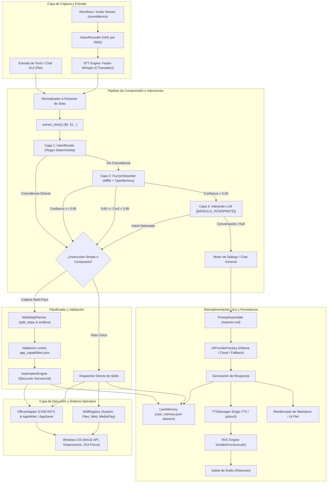
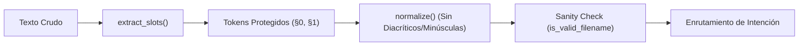
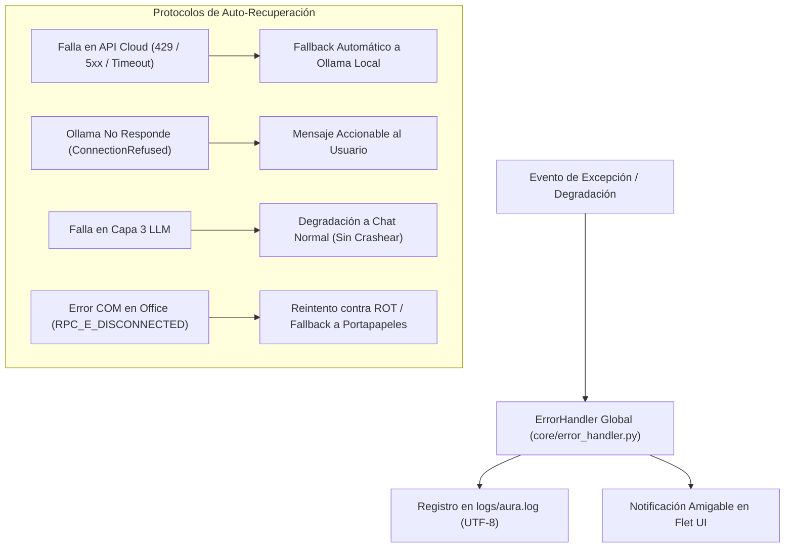

# Manual Técnico de Arquitectura y Mantenimiento
**Proyecto: AURA (Asistente Universal con Respuesta Automatizada) — Nombre Interno: Orion**  
*Documento de Ingeniería de Software, Ciencia de Datos y Operaciones (MLOps / SysOps)*  
*Versión: 1.4.15 | Entorno: Windows 10/11 64-bit | Runtime: Python 3.11.x*

---

## 1. Visión General del Sistema

### 1.1 Nombre del Proyecto y Objetivo Técnico
- **Nombre Público**: AURA (*Asistente Universal con Respuesta Automatizada*)
- **Nombre Clave / Interno**: Orion
- **Objetivo Técnico**:  
  AURA Orion es un asistente de escritorio modular, reactivo y portable, concebido con una arquitectura **Local-First** orientada a la privacidad de datos y la soberanía del usuario. Su objetivo técnico es desacoplar la asistencia digital de servicios en la nube privativos mediante el procesamiento del lenguaje natural (NLP) en local a través de modelos de lenguaje ligeros (LLMs vía Ollama) y modelos acústicos/neurales integrados (STT con Faster-Whisper y TTS/conversión vocal con RVC). El sistema unifica capacidades de automatización operativa sobre el sistema operativo Windows (Win32 API y COM Automation) con un motor conversacional y de razonamiento estructurado, garantizando una degradación elegante ante la ausencia de conexión a internet o de aceleración por GPU.

---

### 1.2 Diagrama de Flujo de Datos del Sistema

El siguiente diagrama en sintaxis Mermaid.js ilustra el flujo integral de datos, desde la adquisición de señales de audio y texto, el enrutamiento multicapa, la planificación secuencial, hasta la ejecución física sobre el sistema operativo y la persistencia atómica de la memoria:



---

### 1.3 Stack Tecnológico

El stack técnico está rigurosamente seleccionado para asegurar portabilidad, bajo consumo de recursos y ausencia de dependencias con instaladores globales:

| Componente | Tecnología | Versión / Especificación | Rol en la Arquitectura |
| :--- | :--- | :--- | :--- |
| **Lenguaje Base** | Python | `3.11.x` (64-bit strict) | Motor de ejecución unificado. Validado en `run.py` y aislado en `./env`. |
| **Framework de GUI** | Flet | `0.86.5` (pinneado) | Arquitectura reactiva basada en Flutter para la interfaz de escritorio. |
| **Inferencia STT** | Faster-Whisper | `~1.0.0` (CTranslate2) | Reconocimiento de voz local con cuantización INT8 (CPU) o FP16 (CUDA). |
| **Motor TTS** | Edge-TTS / pyttsx3 | `~7.0.0` / `~2.90` | Generación de síntesis fonética base de alta naturalidad. |
| **Conversión Vocal (VC)**| RVC-Python / PyTorch | `rvc-python>=0.1.5`, `torch>=2.0` | Inferencia neuronal de clonación tímbrica sobre modelos V2/V1 (`.pth` + `.index`). |
| **Adquisición de Audio** | Sounddevice / NumPy | `sounddevice>=0.5.0`, `numpy<=1.23.5`| Streaming síncrono/asíncrono de buffers PCM y cálculo vectorizado de RMS. |
| **Integración con el SO**| PyWin32 / Psutil | `pywin32>=306`, `psutil>=5.9.0` | Automatización COM nativa (Word, Excel), manipulación de HWND y procesos. |
| **Gestión de Archivos** | Send2Trash | `>=1.8.2` | Eliminación segura enviando a la Papelera de Reciclaje de Windows. |
| **Serialización** | PyYAML / JSON nativo | `pyyaml>=6.0.1`, `json` stdlib | Persistencia de configuraciones, memorias y flujos de automatización en UTF-8. |
| **Conectividad HTTP** | Requests | `>=2.31.0` | Cliente HTTP puro (`AIHttpClient`) con backoff y reintentos, sin SDKs pesados. |
| **Control de Calidad** | Pytest / Pyflakes | `pytest>=7.0.0`, `pyflakes>=3.0.0` | Testing automatizado de regresión y análisis estático de código libre de warnings. |

---

## 2. Pipeline de Datos y Transformaciones

### 2.1 Fuentes de Datos
1. **Flujos de Señal Acústica (PCM)**: Captura en tiempo real mediante buffers de audio de 16-bit a 16 kHz o tasa nativa de tarjeta de sonido (44.1 kHz / 48 kHz).
2. **Entradas Discretas de Usuario**: Mensajes textuales emitidos desde la interfaz conversacional Flet o transcribibles vía el pipeline de voz.
3. **Telemetría de Procesos y Ventanas**: Muestreo dinámico de la tabla de procesos del sistema operativo (`psutil.process_iter`), registro de clases y títulos de ventanas activas (`win32gui`) e instancias de la Running Object Table (ROT) mediante COM.
4. **Almacenamiento Local Semántico y Operacional**:
   - `data/conversations/*.json`: Histórico conversacional particionado por sesión.
   - `data/memory/user_memory.json`: Grafo de memoria a largo plazo, preferencias y contexto de proyecto.
   - `data/learning/typo_memory.json`: Registro incremental de errores léxicos aprendidos.
   - `data/app_capabilities.json`: Matriz de contratos de automatización por aplicación.

---

### 2.2 Proceso de Data Wrangling, Tokenización y Normalización

El sistema implementa un preprocesamiento determinista y seguro antes de someter cualquier entrada a modelos probabilísticos:



#### A. Extracción y Protección de Slots (`extract_slots`)
Para evitar que conjunciones coordinantes (*"y"*, *", luego"*, *"después"*) fragmenten títulos de archivos o textos literales dentro de cadenas compuestas, la función `extract_slots` (`aura/core/planner.py`) extrae expresiones entrecomilladas (`"..."`, `'...'`, `“...”`, `‘...’`, `` `...` ``) y las reemplaza por placeholders deterministas:
$$\text{Texto: } \text{"abre notepad y escribe 'pan y queso'"} \longrightarrow \text{"abre notepad y escribe §0"}$$
Los slots son resguardados en memoria y restituidos posteriormente sobre los parámetros de los pasos (`restore_slots`).

#### B. Normalización Léxica y Fonética
La función `normalize()` (`aura/core/intent_router.py`) ejecuta:
1. Conversión total a caja baja (`lower()`) y remoción de espacios sobrantes (`strip()`).
2. Mapeo estricto de caracteres diacríticos españoles a sus equivalentes base:
   $$\{á, à, â\} \to a, \quad \{é, è, ê\} \to e, \quad \{í, ì, î\} \to i, \quad \{ó, ò, ô\} \to o, \quad \{ú, ù, ü, û\} \to u$$
3. Eliminación de prefijos de cortesía y preguntas indirectas mediante expresiones regulares precompiladas:
   $$\text{Patrón: } \wedge(\text{por favor}\mid\text{podes}\mid\text{puedes}\mid\text{podrias})\backslash s+$$

#### C. Control de Integridad de Nombres de Archivo (`is_valid_filename`)
Filtro de contención que previene inyecciones o falsos positivos de archivos:
- Rechaza caracteres prohibidos en el subsistema NTFS/FAT32: `< > : " | ? * \ /`.
- Rechaza targets que contengan verbos de comando reservados (`escribe`, `abre`, `cierra`, `borra`, etc.).
- Rechaza cadenas sin extensión con más de cuatro palabras independientes.

#### D. Pipeline de Audio y Voice Activity Detection (VAD)
El módulo `voice/audio_manager.py` procesa los chunks de entrada para la detección de habla:
1. **Cálculo de Energía RMS Vectorizada**:
   $$\text{RMS} = \sqrt{\frac{1}{N} \sum_{i=1}^{N} x_i^2}$$
2. **Evaluación de Silencio Dinámica**: Si $\text{RMS} < \text{VOICE\_SILENCE\_RMS}$ durante un tiempo acumulado $\ge \text{VOICE\_SILENCE\_SECONDS}$, el disparador asume fin de elocución y remite el buffer concatenado a inferencia. Si transcurren $\text{VOICE\_WAIT\_SPEECH\_SECONDS}$ sin superar el umbral, la captura aborta por inactividad.
3. **Resampling**: Si la tarjeta física opera a frecuencia distinta de 16,000 Hz, se remuestrea mediante interpolación lineal NumPy para abastecer la arquitectura acústica de Whisper.

---

### 2.3 Diccionario de Variables y Metadatos

A continuación se documenta el esquema de datos persistentes en los almacenes JSON/YAML locales:

#### Esquema de Memoria de Usuario (`data/memory/user_memory.json`)
| Clave | Tipo | Descripción | Restricciones / Formato |
| :--- | :--- | :--- | :--- |
| `version` | `str` | Versión del esquema de persistencia. | Ejemplo: `"1.0"` |
| `updated_at` | `str` | Marca de tiempo de última sincronización. | Formato ISO 8601 (`YYYY-MM-DDTHH:MM:SS.mmmmmm`) |
| `preferences` | `dict` | Parámetros clave-valor configurados por el usuario. | Claves alfanuméricas con valores primitivos serializables. |
| `current_project` | `str \| null` | Ruta normalizada del proyecto en desarrollo activo. | Ruta absoluta resuelta o `null`. |
| `paths[]` | `list[object]` | Registro de rutas navegadas o referenciadas. | Objeto `PathMemoryEntry`: `{path, alias, access_count, last_accessed, category}`. |
| `programs[]` | `list[object]` | Historial de aplicaciones ejecutadas y frecuencia. | Objeto `ProgramUsageEntry`: `{name, executable, launch_count, last_launched, category}`. |
| `projects[]` | `list[object]` | Proyectos registrados y notas contextuales. | Objeto `ProjectContextEntry`: `{name, path, project_type, session_notes, access_count}`. |
| `facts[]` | `list[object]` | Memoria semántica de hechos a largo plazo. | Objeto `UserFact`: `{id, content, category, tags, confidence, created_at}`. |

#### Esquema de Registro de Capacidades (`data/app_capabilities.json`)
| Atributo | Tipo | Valores Permitidos | Propósito Técnico |
| :--- | :--- | :--- | :--- |
| `write` | `str \| null` | `"clipboard"`, `"com"`, `null` | Método de inyección de texto en el proceso (Portapapeles vs. COM Dispatch). |
| `read` | `str \| null` | `"win32_edit"`, `"com"`, `null` | Método de extracción de buffers de texto desde la ventana activa. |
| `save_as` | `str \| null` | `"com"`, `"win32_dialog"`, `null`| Mecanismo de persistencia de documentos en disco. |
| `focus_hint` | `str` | Secuencia de teclas (ej: `""`, `"{ESC}"`) | Acciones preparatorias para garantizar foco de control antes de escribir. |

#### Esquema de Memoria de Typos (`data/learning/typo_memory.json`)
| Atributo | Tipo | Descripción |
| :--- | :--- | :--- |
| `typos.<err>` | `object` | Diccionario indexado por el token erróneo normalizado (ej: `"notepa d"`). |
| `target` | `str` | Entidad o ejecutable canónico resuelto (ej: `"notepad"`). |
| `intent` | `str` | Intención validada durante el aprendizaje (ej: `"open_app"`, `"close_app"`). |
| `confidence` | `float` | Nivel de certidumbre registrado en el aprendizaje ($0.0 \le c \le 1.0$). |
| `layer` | `int` | Capa del pipeline que resolvió el patrón ($1, 2 \text{ ó } 3$). |

---

## 3. Especificación del Modelo / Motor de IA

### 3.1 Arquitectura del Modelo y Clasificadores

AURA Orion emplea una arquitectura híbrida desacoplada compuesta por clasificadores jerárquicos y motores generativos:

```
[Entrada de Usuario]
         │
         ▼
┌────────────────────────────────────────────────────────┐
│ Capa 1: Clasificador Determinista (Regex / Tokenizer)   │
└────────────────────────────────────────────────────────┘
         │ (Si no hay match)
         ▼
┌────────────────────────────────────────────────────────┐
│ Capa 2: Clasificador Difuso (difflib SequenceMatcher)  │
│         + Base de Datos de Typos Aprendidos            │
└────────────────────────────────────────────────────────┘
         │ (Si confianza < 0.60)
         ▼
┌────────────────────────────────────────────────────────┐
│ Capa 3: Intérprete LLM (Inferencia Estructurada JSON)  │
└────────────────────────────────────────────────────────┘
```

1. **Clasificador Determinista (Capa 1 - `IntentRouter`)**:
   - Análisis sintáctico mediante autómatas finitos no deterministas (expresiones regulares compiladas en Python).
   - Enruta 13 intenciones formales: `open_url`, `create_folder`, `create_file`, `rename_file`, `move_file`, `delete_file`, `search_file`, `close_app`, `open_app`, `write_in_app`, `save_app_doc`, `media_play`, `pedir_chiste`/`roast`.
2. **Clasificador Difuso con Memoria Léxica (Capa 2 - `FuzzyInterpreter`)**:
   - Algoritmo: Basado en el algoritmo Ratcliff/Obershelp (`difflib.SequenceMatcher`).
   - Calcula coeficientes de similitud contra verbos canónicos y bases de datos de aplicaciones (`programs.json`, accesos directos `.lnk` y procesos en ejecución).
3. **Agente de NLP e Inferencia LLM (Capa 3 & Chat General)**:
   - Capa abstracta `BaseAIProvider` que implementa el patrón Factory (`AIProviderFactory`).
   - **Modo Local**: LLMs cuantizados ejecutados sobre Ollama (`qwen2.5:3b` por defecto, `llama3.2:3b`, `phi3:mini`).
   - **Modo Cloud**: Adaptadores REST HTTP directos para OpenAI (`gpt-4o-mini`), Google Gemini (`gemini-2.0-flash`), Anthropic (`claude-3-5-haiku-latest`) y xAI Grok.
4. **Modelos Acústicos y Transformadores de Voz**:
   - **STT**: `faster-whisper-tiny` / `base` basado en arquitectura Encoder-Decoder Transformer implementado en CTranslate2 con capas de atención cuantizadas a 8 bits.
   - **Conversión de Voz (RVC)**: Retrieval-based Voice Conversion basado en VITS (Variational Inference with adversarial learning for end-to-end Text-to-Speech) optimizado con índices FAISS para coincidencia tímbrica.

---

### 3.2 Parámetros de Inferencia y Operación

AURA Orion prohíbe de forma estricta la escalación dinámica o acumulativa de temperatura para prevenir derivas alucinatorias (*prompt drift*). Los parámetros de inferencia están estrictamente fijados según el contexto operativo:

| Contexto Operativo | Temperatura ($T$) | Top-P ($p$) | Repeat Penalty | Max Tokens | Justificación Técnica |
| :--- | :--- | :--- | :--- | :--- | :--- |
| **Intérprete Capa 3 (`[MODULO_INTERPRETE]`)** | `0.10` | `0.90` | `1.05` | `128` | Garantizar estricta validez sintáctica de la estructura JSON. |
| **Planificador Multi-Paso (`[MODULO_PLAN]`)** | `0.10` | `0.90` | `1.05` | `256` | Estructuración determinista de listas de pasos. |
| **Asistente de Programación (`[MODULO_PROGRAMACION]`)**| `0.20` | `0.95` | `1.10` | `2048`| Precisión sintáctica de código sin alucinaciones de librerías. |
| **Chat General / Didáctico (`[MODULO_CHAT]`)** | `0.70` | `0.90` | `1.10` | `1024`| Equilibrio entre fluidez lingüística y coherencia factual. |
| **Generador de Humor (`[MODULO_HUMOR]`)** | `0.75` | `0.90` | `1.10` | `120` | Variabilidad estocástica controlada con remate breve. |
| **Inferencia STT Whisper** | `0.00` | N/A | N/A | N/A | Greedy search determinista con `beam_size=5` y `vad_filter=True`. |
| **Inferencia RVC** | Pitch: `0` | N/A | Index Rate: `0.6` | N/A | Balance entre la fidelidad tímbrica y la inteligibilidad fonética. |

---

### 3.3 Arquitectura y Ensamblado de Prompts (Prompt Maestro `maestro.md`)

El núcleo cognitivo se rige por un archivo canónico único: `aura/ai/prompts/maestro.md`, gestionado dinámicamente por `aura/ai/prompt_assembler.py`.

```
                    ┌────────────────────────┐
                    │   maestro.md (Disco)   │
                    └───────────┬────────────┘
                                │
                                ▼
                    ┌────────────────────────┐
                    │   PromptAssembler      │
                    │   - Parseo de Secciones│
                    │   - Regla de Modelo    │
                    └───────────┬────────────┘
                                │
        ┌───────────────────────┴───────────────────────┐
        ▼                                               ▼
[Modelo <= 4B (Local)]                         [Modelo >= 7B o Cloud]
- [NUCLEO]                                     - [NUCLEO]
- [MODULO_ESPECÍFICO]                          - [MODULO_ESPECÍFICO]
- [PERSONALIDAD] (Al final)                    - [EJEMPLOS]
                                               - [PERSONALIDAD] (Al final)
```

#### Estructura Modular de Secciones:
- `[NUCLEO]`: Inyectado en **todas** las llamadas sin excepción. Define la identidad bifásica (Mitad Ejecutora vs. Mitad Conversacional), la regla de honestidad operativa, el protocolo de razonamiento interno en 6 pasos y las políticas de seguridad destructiva.
- `[MODULO_INTERPRETE]`: Sustituye las reglas de salida por la emisión exclusiva de un objeto JSON sin bloques Markdown:
  ```json
  {"tipo":"comando"|"conversacion", "intent":"...", "target":"...", "texto":"...", "confianza":0.0-1.0}
  ```
- `[MODULO_PLAN]`: Emisión exclusiva de un JSON con el array de pasos ordenados secuencialmente:
  ```json
  {"pasos":[{"intent":"...", "target":"...", "texto":"...", "service":"..."}], "confianza":0.0-1.0}
  ```
- `[MODULO_CHAT]`, `[MODULO_HUMOR]`, `[MODULO_PROGRAMACION]`: Contextos especializados para diálogo, comedia estructurada o depuración de código.
- `[EJEMPLOS]`: Conjunto de pares de Few-Shot positivos. **Omitidos automáticamente** si el modelo en ejecución es $\le 4\text{B}$ (`is_small_model`) para preservar la ventana de contexto de modelos como `qwen2.5:3b`.

#### Regla Mandatoria de Precedencia:
> *El protocolo de razonamiento, los umbrales de confianza, las reglas de salida de comandos y los límites de seguridad del NÚCLEO tienen precedencia absoluta sobre la personalidad. La personalidad solo puede alterar el tono y el estilo lingüístico, jamás modificar las decisiones del sistema ni evadir confirmaciones de seguridad.*

---

### 3.4 Métricas de Desempeño y Umbrales Operativos

El motor opera bajo umbrales de corte cuantitativos para la toma de decisiones:

- **Umbral de Ejecución Directa ($\ge 0.85$)**: Con un único candidato resuelto, ejecuta la acción inmediatamente informando al usuario.
- **Umbral de Ejecución con Aclaración ($0.60 \le C < 0.85$)**: Con un único candidato, ejecuta indicando la corrección efectuada (ej: `Entendí "cerrar notepad"`).
- **Umbral de Desambiguación Interactiva ($0.60 \le C < 0.85$)**: Con múltiples candidatos viables, suspende la ejecución y solicita clarificación con un listado estructurado.
- **Límite de Pasos en Cadena (`PLAN_MAX_STEPS`)**: Máximo 8 acciones secuenciales por comando compuesto.
- **Tolerancia de Falla en Cadenas (`PLAN_ON_ERROR`)**: Por defecto `stop` (aborto inmediato del resto de la cadena ante el primer fallo) o `continue` según configuración.

---

## 4. Guía de Despliegue y Configuración

### 4.1 Requisitos del Sistema

| Recurso | Modo Local Óptimo (Ollama Qwen2.5:3B) | Modo Cloud (APIs Externas) |
| :--- | :--- | :--- |
| **Sistema Operativo** | Windows 10/11 (64-bit) | Windows 10/11 (64-bit) |
| **Procesador (CPU)** | 4 núcleos / 8 hilos (Intel Core i5 8va gen / AMD Ryzen 3 3000+) | 2 núcleos (Intel Core i3 / equivalente) |
| **Memoria RAM** | 8 GB mínimo (16 GB recomendado para buffer RVC) | 4 GB a 8 GB |
| **Tarjeta Gráfica (GPU)**| Opcional: NVIDIA GTX/RTX con 4-6 GB VRAM (CUDA 12.x) | No obligatoria (gráficos integrados) |
| **Almacenamiento** | 10 GB a 15 GB libres (SSD recomendado) | 3 GB a 5 GB libres |
| **Conectividad de Red** | No requerida tras la instalación inicial de dependencias | Conexión constante a Internet (HTTPS saliente) |

---

### 4.2 Instalación de Dependencias y Entorno Portable

AURA Orion prohíbe instalaciones globales en el sistema operativo. Todo el despliegue se realiza en un entorno virtual aislado en `%~dp0env` mediante scripts por lotes que utilizan obligatoriamente `%~dp0` para garantizar portabilidad:

#### 1. Inicialización Automatizada del Entorno
Ejecutar el script por lotes:
```bat
setup_env.bat
```
El script efectúa internamente:
1. Verificación rigurosa de Python 3.11 mediante `py -3.11` o `python`. Si la versión difiere, aborta sin generar entornos defectuosos.
2. Creación del entorno virtual portable en `%~dp0env`.
3. Actualización de `pip`, `setuptools` y `wheel`.
4. Instalación de librerías desde `%~dp0requirements.txt`.
5. Si no existe `.env`, crea una copia limpia inicial desde `.env.example`.

#### 2. Configuración de Cómputo PyTorch (CPU vs. CUDA)
Para optimizar el tamaño en disco y el rendimiento según el hardware:
- **Para entornos sin GPU dedicada (Modo CPU Ligero, ahorra ~2.5 GB)**:
  ```cmd
  .\env\Scripts\pip.exe install torch torchvision torchaudio --index-url https://download.pytorch.org/whl/cpu
  ```
- **Para entornos con GPU NVIDIA compatible (Aceleración CUDA)**:
  ```cmd
  .\env\Scripts\pip.exe install torch torchvision torchaudio --index-url https://download.pytorch.org/whl/cu121
  ```

---

### 4.3 Variables de Entorno Requeridas (`.env`)

El archivo `.env` gobierna el comportamiento de los subsistemas. A continuación se detallan las variables principales sin exponer secretos de producción:

```ini
# ==============================================================================
# CONFIGURACIÓN DEL PROVEEDOR DE INTELIGENCIA ARTIFICIAL
# ==============================================================================
# Proveedor principal: 'ollama' | 'gemini' | 'openai' | 'anthropic' | 'mock'
AI_PROVIDER='ollama'
AI_MODEL='qwen2.5:3b'
OLLAMA_URL='http://localhost:11434'
AI_ALLOW_MOCK='false'              # 'true' EXCLUSIVAMENTE para tests automatizados
AI_FALLBACK_OLLAMA='true'          # Conmuta a Ollama si la nube falla
AI_HTTP_TIMEOUT='30'               # Timeout en segundos para requests HTTP

# Credenciales Cloud (Reemplazar con keys válidas si se usan proveedores externos)
OPENAI_API_KEY='tu_openai_api_key_aqui'
ANTHROPIC_API_KEY='tu_anthropic_api_key_aqui'
GEMINI_API_KEY='tu_gemini_api_key_aqui'
XAI_API_KEY='tu_xai_api_key_aqui'

# ==============================================================================
# SUBSISTEMA DE AUDIO, VOZ Y RECONOCIMIENTO (STT / TTS / RVC)
# ==============================================================================
STT_PROVIDER='whisper'             # 'whisper' | 'sr' (Google Web Speech) | 'mock'
WHISPER_MODEL='tiny'               # 'tiny' | 'base' | 'small' | 'medium'
WHISPER_VAD='true'
AUDIO_INPUT_DEVICE=''              # Nombre o índice de micrófono (vacío = default)
AUDIO_OUTPUT_DEVICE=''             # Nombre o índice de salida (vacío = default)
VOICE_SILENCE_RMS='0.025'          # Umbral de energía RMS para corte de silencio
VOICE_SILENCE_SECONDS='1.8'        # Tiempo continuo de silencio para disparar envío
VOICE_WAIT_SPEECH_SECONDS='6.0'    # Tiempo máximo de espera inicial de voz
TTS_PROVIDER='rvc'                 # 'rvc' | 'edge' | 'system'
RVC_VOZ='aura'                     # Carpeta en models/rvc/<voz>
RVC_TTS_BASE='edge'
RVC_TTS_BASE_VOICE='es-MX-DaliaNeural'
RVC_PITCH='0'                      # Desplazamiento en semitonos (-12 a +12)
RVC_INDEX_RATE='0.6'               # Peso del índice de recuperación tímbrica
RVC_DEVICE='auto'                  # 'auto' | 'cuda' | 'cpu'

# ==============================================================================
# PLANIFICADOR MULTI-PASO Y SISTEMA OPERATIVO
# ==============================================================================
PLAN_MAX_STEPS='8'                 # Límite superior de pasos por instrucción
PLAN_WAIT_APP_SECONDS='5'          # Tiempo límite para confirmar foco de ventana
PLAN_WAIT_PAGE_SECONDS='2'         # Intervalo entre navegaciones web
PLAN_ON_ERROR='stop'               # 'stop' (aborta cadena) | 'continue'
PLAN_STRICT='false'                # 'true' para abortar si una capacidad no existe
BROWSER_PREFERIDO='firefox'        # 'firefox' | 'chrome' | 'edge'
MEDIA_SERVICE='youtube_music'      # 'youtube_music' | 'spotify' | 'youtube'

# ==============================================================================
# PERSONALIDAD Y POLÍTICAS DE SEGURIDAD
# ==============================================================================
AURA_PERSONALITY='sin_filtro'      # 'profesional' | 'amigable' | 'sarcastico' | 'sin_filtro'
AURA_RUDE_LEVEL='5'                # Nivel numérico de 0 a 5
CONFIRM_DESTRUCTIVE='true'         # Confirmación obligatoria para borrar o apagar
CONFIRM_SHUTDOWN='true'
PROMPT_MAESTRO='true'              # Activa el sistema canónico maestro.md
PROMPT_DEBUG='false'               # Si 'true', loguea prompts en logs/prompt_assembled.log
WORKSPACE_PATH='./workspace'
```

---

## 5. Mantenimiento y Reentrenamiento

### 5.1 Procedimiento de Actualización de Modelos y Ajuste de Parámetros

#### A. Actualización de Modelos Locales en Ollama
1. Descarga del nuevo checkpoint desde la línea de comandos de Windows:
   ```bash
   ollama pull qwen2.5:7b
   ```
2. Modificar la variable en `.env`:
   ```ini
   AI_MODEL='qwen2.5:7b'
   ```
3. Reiniciar AURA. El ensamblador de prompts (`PromptAssembler`) detectará que el modelo supera los 4B de parámetros y habilitará automáticamente la inyección de la sección `[EJEMPLOS]` en el system prompt.

#### B. Integración de Nuevas Voces en el Motor RVC
1. Crear una subcarpeta nombrada con el identificador de la voz en `models/rvc/<nombre_voz>/`.
2. Ubicar el archivo de pesos entrenados (`<nombre_voz>.pth`) y opcionalmente el índice de características FAISS (`<nombre_voz>.index`).
3. Configurar en `.env`:
   ```ini
   RVC_VOZ='<nombre_voz>'
   ```
4. El cargador en memoria `voice/tts/rvc_converter.py` detectará automáticamente los nuevos artefactos sin necesidad de modificar el código fuente.

#### C. Ciclo de Auditoría y Limpieza Segura (`safe_clean.py`)
Para mantener el repositorio ligero y libre de artefactos temporales:
```cmd
.\env\Scripts\python.exe scripts\safe_clean.py
```
*Operaciones ejecutadas:*
- Purgado de cachés `__pycache__`, `.pyc` y `.pyo`.
- Limpieza de logs rotados antiguos (`aura.log.1`, etc.).
- Eliminación de frames de animación regenerables en `assets/backgrounds/cache/`.
- Protección estricta: **nunca** elimina modelos RVC, archivos `.env`, bases de datos SQLite/JSON reales ni código fuente.

#### D. Empaquetado y Distribución de Releases Portables (`make_release.py`)
Para generar un paquete de distribución limpio (~60 a 70 MB) libre de datos confidenciales:
```cmd
.\env\Scripts\python.exe scripts\make_release.py --out ./release
```
*Mecanismo de seguridad estricto:*
- Sanitiza automáticamente `.env` generando un `.env.example` con placeholders.
- Realiza una validación previa no eludible: si el archivo `.env` real o la carpeta `env/` se detectan dentro del staging, la operación aborta de inmediato destruyendo los archivos temporales.

---

### 5.2 Puntos de Monitoreo de Fallas y Recuperación



#### 1. Monitoreo de Deriva de Datos (*Data Drift / Typo Drift*)
- **Punto de Inspección**: Archivo `data/learning/typo_memory.json` y logs de `aura.core.fuzzy_interpreter`.
- **Síntoma**: Disminución progresiva de ejecuciones en Capa 1 y saturación de derivaciones a Capa 3.
- **Acción Correctiva**: Auditar las entradas de `typo_memory.json`. Si existen asignaciones erróneas aprendidas, depurar la clave correspondiente o reiniciar el diccionario.

#### 2. Monitoreo de Fallas de Prompt (*Prompt Failure & Hallucination*)
- **Punto de Inspección**: Archivo `logs/prompt_assembled.log` (habilitando `PROMPT_DEBUG=true`).
- **Síntoma**: El modelo emite respuestas conversacionales cuando se solicita JSON estructurado en `[MODULO_INTERPRETE]` o `[MODULO_PLAN]`.
- **Acción Correctiva**:
  1. Verificar que no se haya modificado la temperatura (`T <= 0.10`).
  2. Verificar que no se hayan introducido caracteres de control o emojis en la plantilla del prompt del sistema.
  3. Comprobar que el parser `extract_slots` haya cerrado todos los identificadores `§n`.

#### 3. Monitoreo de Conectividad y Fallback de Proveedores
- **Punto de Inspección**: Métricas reportadas por `FallbackProvider` en `logs/aura.log`.
- **Comportamiento Esperado**: Si el proveedor en la nube retorna error HTTP 429 (límite de cuota) o 500 (caída del servicio), el sistema conmuta transparentemente a Ollama local registrando:
  `"☁️ Falló <provider>, usando Ollama local"`
- Si el servicio Ollama local tampoco está activo, se emite una notificación clara sin stacktrace crudo:
  `"❌ No hay proveedor de IA disponible. Ollama no responde en localhost:11434 (inicialo con 'ollama serve') o configurá un proveedor con API key en Configuración."`

#### 4. Monitoreo de Procesos y Automatizaciones de Office
- **Punto de Inspección**: `core/office_adapter.py` y `skills/builtin/app_writer.py`.
- **Condiciones de Falla**:
  - Diálogos modales emergentes en Word/Excel que bloquean la interfaz COM.
  - El adapter implementa `GetActiveObject` estricto; si el usuario no tiene la aplicación abierta, no crea instancias huérfanas en segundo plano. Si la llamada COM falla, degrada al método alternativo registrado en `app_capabilities.json` (escritura vía portapapeles y simulación de teclado Win32).

---

## 6. Marco de Responsabilidad, Privacidad y Seguridad

En estricto cumplimiento con las directivas de seguridad informática y privacidad de datos:

1. **Aislamiento de Credenciales**:
   - Queda terminantemente prohibido almacenar tokens, contraseñas de red o API keys en código fuente, archivos de memoria semántica (`user_memory.json`) o cadenas de logs.
   - En la interfaz gráfica y en los archivos de registro, las claves se ofuscan permanentemente bajo el formato `sk-...XXXX`.
2. **Operaciones Críticas e Irreversibles**:
   - Operaciones de borrado permanente, vaciado de papelera, apagado o reinicio de equipo (`shutdown /r`), y ejecución de scripts locales exigen obligatoriamente la confirmación explícita del usuario mediante un diálogo modal (`CONFIRM_DESTRUCTIVE=true`), independientemente del nivel de confianza reportado por el modelo de IA.
3. **Saneamiento de Rutas**:
   - Todos los scripts, comandos y manuales deben abstenerse de documentar o codificar rutas locales absolutas del entorno de desarrollo. Se emplean rutas relativas al workspace o variables portables dinámicas (`%~dp0` en Windows batch).
4. **Codificación Universal Estricta**:
   - Todo flujo de I/O de archivos o streaming de sockets opera bajo codificación **UTF-8 explícita**, inhibiendo el uso de páginas de códigos heredadas del sistema operativo (`CP1252`, `Latin-1`), neutralizando vulnerabilidades por corrupción de datos o desbordamientos (*mojibake*).
